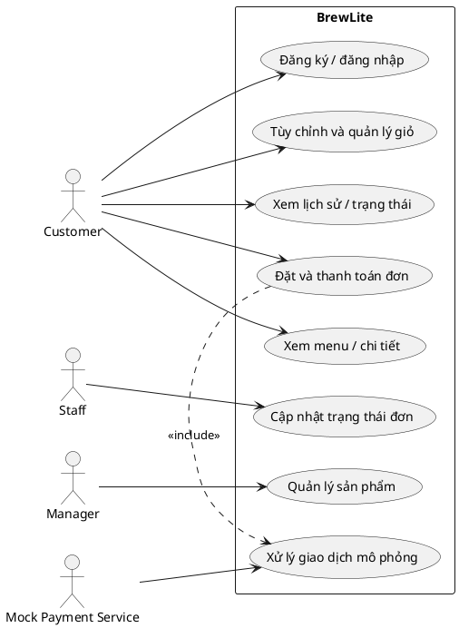

# BrewLite - SRS rút gọn

Ưu tiên: Must = bắt buộc MVP; Should = nên có; Could = mở rộng; Won't = không làm trong assignment. AC là tiêu chí kiểm chứng.

| ID | Yêu cầu | Ưu tiên | Tiêu chí chấp nhận |
|---|---|---|---|
| FR-01 | Khách xem menu đang bán | Must | GET /products trả sản phẩm active; UI có loading, empty, error |
| FR-02 | Xem chi tiết, size, topping và giá | Must | GET /products/:id trả tùy chọn; API xác nhận tổng giá |
| FR-03 | Quản lý giỏ hàng | Must | Thêm/sửa/xóa; tổng tiền đúng theo số lượng/tùy chọn |
| FR-04 | Đăng ký/đăng nhập | Must | JWT hợp lệ; mật khẩu băm; sai thông tin bị từ chối |
| FR-05 | Tạo đơn | Must | POST /orders cần JWT và Idempotency-Key; lưu snapshot giá/items |
| FR-06 | Thanh toán không tiền mặt mô phỏng bằng Ví/Thẻ | Must | Với giỏ có ít nhất 1 món, chọn Ví/Thẻ; thành công hiển thị mã đơn + PAID; thất bại giữ giỏ và ghi PAYMENT_FAILED; retry cùng key không tạo payment trùng |
| FR-07 | Xem xác nhận và lịch sử đơn | Must | Chỉ xem đơn của mình; mã đơn, trạng thái/tổng tiền nhất quán; lịch sử có trạng thái cập nhật |
| FR-08 | Nhân viên cập nhật trạng thái và quản trị xem đơn | Must | Chỉ STAFF/MANAGER xem/lọc đơn và chuyển trạng thái hợp lệ: PAID → PREPARING → READY → COMPLETED; trạng thái cuối không chuyển tiếp |
| FR-09 | Promotion và loyalty | Must | Khách xác thực mã còn hạn và đạt giá trị tối thiểu; API tự tính giảm giá; quản trị tạo/bật/tắt mã; đơn thanh toán thành công tích điểm đúng một lần |
| FR-10 | Quản lý danh mục | Should | Quản trị viên sửa/ẩn; giá không âm |
| FR-11 | Không đặt khi hết hàng | Must | Transaction từ chối nguyên tử, không trừ tồn một phần; tồn được cập nhật bằng optimistic version check để phát hiện cạnh tranh |
| FR-12 | Hủy giỏ/đơn chưa thanh toán | Could | Chỉ trạng thái hợp lệ; hoàn tồn đúng một lần |
| NFR-01 | Hiệu năng | Should | P95 GET /products < 500 ms local với 100 sản phẩm, không tính cold start |
| NFR-02 | Bảo mật | Must | Hash mật khẩu, JWT secret từ env, DTO validation, không trả secret |
| NFR-03 | Khả dụng | Should | /health báo API/DB; lỗi UI dễ hiểu |
| NFR-04 | Toàn vẹn | Must | Order/items/trừ tồn trong transaction; idempotency unique |
| NFR-05 | Triển khai | Must | Compose chạy web/API/DB; migration/seed tái tạo DB |
| NFR-06 | Bảo trì | Should | Lint, unit/integration, build tự động trên PR |
| NFR-07 | Mobile-first | Must | Dùng được từ viewport 360px, keyboard accessible |
| NFR-08 | Riêng tư thanh toán | Must | Không lưu PAN/CVV; chỉ lưu provider reference/trạng thái |

## Use-case tổng quát

